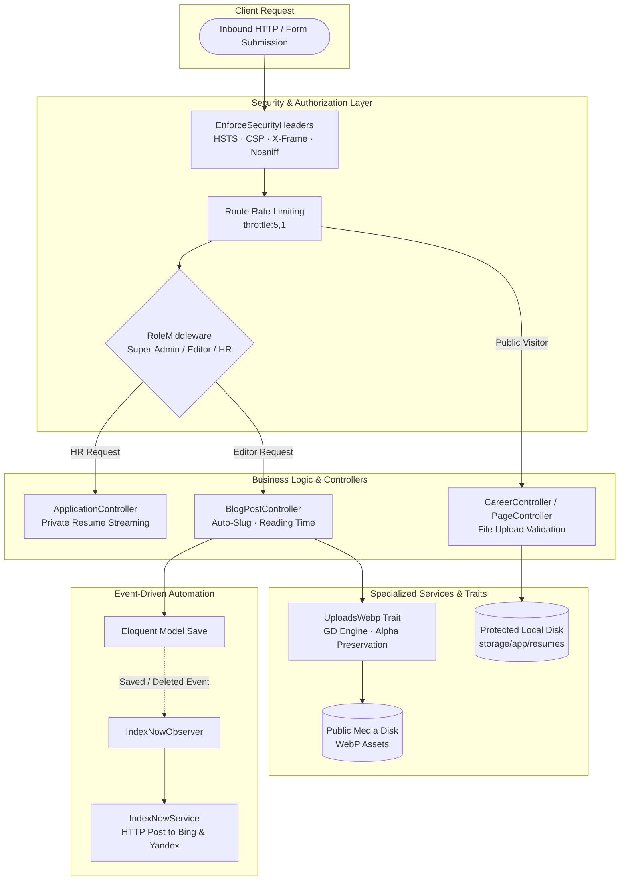

<div align="center">

# 🌐 IntliEx — Engineering Portfolio & Code Showcase
### *Problems Solved, Architectural Decisions & Source Code Deep Dive*

[](https://www.php.net)
[](https://laravel.com)
[](https://github.com)
[](https://github.com)

<p align="center">
  <b>This repository is a curated technical showcase highlighting core software engineering solutions, design patterns, and domain implementations from the IntliEx enterprise platform.</b>
</p>

</div>

---

## 🧭 About This Showcase

Rather than presenting standard framework boilerplate or configuration files, this repository is focused strictly on **production-grade engineering logic, architectural patterns, and real-world problem solving**. 

**IntliEx** is an enterprise-scale multi-domain technology platform delivering solutions across **ERP & Softwares, Artificial Intelligence, Networking, Industrial Automation, and Cloud Services**. 

Below is an exhaustive breakdown of the architectural challenges encountered, the engineering solutions designed, and the exact files in this repository that implement them.

---

## 📊 Problem-to-Code Solution Matrix

| # | Engineering Problem | Solution Pattern | Core Files / Implementation |
| :--- | :--- | :--- | :--- |
| **1** | **Search Engine Crawl Delays & Stale Indexing** | Event-Driven Observer + API Dispatcher | [`app/Observers/IndexNowObserver.php`](app/Observers/IndexNowObserver.php)<br>[`app/Services/IndexNowService.php`](app/Services/IndexNowService.php)<br>[`app/Providers/AppServiceProvider.php`](app/Providers/AppServiceProvider.php) |
| **2** | **Asset Bloat & Alpha-Channel Transparency Loss** | Reusable GD Image Optimization Trait | [`app/Traits/UploadsWebp.php`](app/Traits/UploadsWebp.php)<br>[`app/Http/Controllers/Admin/BlogPostController.php`](app/Http/Controllers/Admin/BlogPostController.php)<br>[`app/Http/Controllers/Admin/CaseStudyController.php`](app/Http/Controllers/Admin/CaseStudyController.php) |
| **3** | **Multi-Department Privilege Escalation (RBAC)** | Multi-Tier Middleware & Route Gates | [`app/Http/Middleware/RoleMiddleware.php`](app/Http/Middleware/RoleMiddleware.php)<br>[`app/Http/Middleware/AdminMiddleware.php`](app/Http/Middleware/AdminMiddleware.php)<br>[`app/Http/Middleware/EnsureCanAccessSettings.php`](app/Http/Middleware/EnsureCanAccessSettings.php)<br>[`app/Models/User.php`](app/Models/User.php)<br>[`routes/web.php`](routes/web.php) |
| **4** | **Applicant Privacy & Resume Exposure Risks** | Private Disk Storage + Streamed Downloads | [`app/Http/Controllers/CareerController.php`](app/Http/Controllers/CareerController.php)<br>[`app/Http/Controllers/Admin/ApplicationController.php`](app/Http/Controllers/Admin/ApplicationController.php)<br>[`app/Models/JobApplication.php`](app/Models/JobApplication.php) |
| **5** | **Clickjacking, MIME Sniffing & Form Spam** | Defense-in-Depth Middleware & Rate Limiting | [`app/Http/Middleware/EnforceSecurityHeaders.php`](app/Http/Middleware/EnforceSecurityHeaders.php)<br>[`routes/web.php`](routes/web.php) |
| **6** | **Multi-Domain Relational Schema Complexity** | Normalized Eloquent Modeling & Route Binding | [`app/Models/Domain.php`](app/Models/Domain.php)<br>[`app/Models/Service.php`](app/Models/Service.php)<br>[`app/Models/ServiceFeature.php`](app/Models/ServiceFeature.php)<br>[`database/migrations/`](database/migrations/) |
| **7** | **Search Engine Discoverability & Rich Snippets** | Dynamic XML Sitemaps & JSON-LD Schemas | [`app/Http/Controllers/SitemapController.php`](app/Http/Controllers/SitemapController.php)<br>[`resources/views/sitemap.blade.php`](resources/views/sitemap.blade.php)<br>[`resources/views/partials/schema.blade.php`](resources/views/partials/schema.blade.php) |

---

## 🔍 Technical Deep Dives: Problems & Code Solutions



---

### Problem 1: Search Engine Crawl Delays & Stale Indexing
- **The Challenge**: Traditional search engine web crawlers take days or weeks to discover newly published blog posts, urgent job listings, and case studies. For a technology firm publishing competitive insights and hiring in real-time, delayed indexation hurts SEO ranking and candidate acquisition.
- **The Architectural Solution**: Built an **event-driven webhook pipeline** using the **IndexNow Protocol**. Instead of waiting for crawlers, model lifecycle hooks directly alert search engines (Bing, Yandex) within seconds of a record being published or updated.
- **Code Highlights**:
  - [`app/Observers/IndexNowObserver.php`](app/Observers/IndexNowObserver.php): Automatically intercepts Eloquent `saved` and `deleted` events on `BlogPost`, `CaseStudy`, and `JobPosting` models. Checks publication status (e.g., `$model->status === 'published'`) before triggering.
  - [`app/Services/IndexNowService.php`](app/Services/IndexNowService.php): Handles HTTP communications with `https://api.indexnow.org/indexnow`, validates keys, manages payload construction, logs responses, and intelligently suppresses calls in local development environments.
  - [`app/Providers/AppServiceProvider.php`](app/Providers/AppServiceProvider.php): Binds the observer cleanly during framework boot.

---

### Problem 2: Media Asset Bloat & Loss of Alpha-Channel Transparency
- **The Challenge**: Content editors upload high-resolution PNGs, JPEGs, and GIFs for logos and featured banners. Uncompressed images degrade Google Core Web Vitals and increase bandwidth costs. However, standard naive GD conversion in PHP frequently strips out 24-bit alpha channels (turning transparent PNGs black) and ruins GIF palette colors.
- **The Architectural Solution**: Designed a reusable trait (`UploadsWebp`) utilizing native GD primitives that inspects MIME signatures, preserves transparency layers, normalizes color spaces, and outputs lightweight WebP binaries with cryptographically randomized file names.
- **Code Highlights**:
  - [`app/Traits/UploadsWebp.php`](app/Traits/UploadsWebp.php):
    - Inspects MIME types via `getimagesize()`.
    - Handles PNGs with `imagepalettetotruecolor()`, `imagealphablending()`, and `imagesavealpha()`.
    - Converts GIFs via palette-to-truecolor conversion.
    - Directly passes existing WebP/AVIF formats to prevent redundant re-compression.
    - Generates 40-character random slugs to eliminate filename collisions on disk.
  - [`app/Http/Controllers/Admin/BlogPostController.php`](app/Http/Controllers/Admin/BlogPostController.php): Uses `$this->uploadAndConvertToWebp($request->file('featured_image'), 'posts')`.
  - [`app/Http/Controllers/Admin/CaseStudyController.php`](app/Http/Controllers/Admin/CaseStudyController.php): Reuses the exact same trait for portfolio imagery.

---

### Problem 3: Multi-Department Privilege Escalation & Access Control (RBAC)
- **The Challenge**: IntliEx operates multiple departments (Content Marketing, HR / Recruitment, Executive Leadership). Granting uniform administrative access creates severe security hazards (e.g., an Editor accidentally modifying system database settings, or viewing confidential applicant salary expectations and resumes).
- **The Architectural Solution**: Built a decoupled, multi-tier **Role-Based Access Control (RBAC)** architecture enforced at both the HTTP kernel level and the Eloquent Model level.
- **Code Highlights**:
  - [`app/Http/Middleware/RoleMiddleware.php`](app/Http/Middleware/RoleMiddleware.php): Verifies incoming user permissions against the route requirement. Supports role inheritance (e.g., `super-admin` possesses universal override).
  - [`app/Http/Middleware/AdminMiddleware.php`](app/Http/Middleware/AdminMiddleware.php): First-line defense guaranteeing unauthenticated or standard public visitors cannot access the `/admin` prefix.
  - [`app/Http/Middleware/EnsureCanAccessSettings.php`](app/Http/Middleware/EnsureCanAccessSettings.php): Isolates company configuration and admin account management to Super Admins only.
  - [`app/Models/User.php`](app/Models/User.php): Implements PHP 8 attributes (`#[Fillable]`, `#[Hidden]`), role scopes (`scopeAdmins`, `scopeEditors`, `scopeHr`), and helper methods (`isSuperAdmin()`, `isEditor()`, `isHr()`).
  - [`routes/web.php`](routes/web.php): Grouped administrative routes under discrete role middleware barriers (`role:editor`, `role:hr`).

---

### Problem 4: Applicant Data Privacy & Resume Exposure Vulnerabilities
- **The Challenge**: Standard web implementations often store candidate CVs in public storage symlinks (`public/storage/resumes`). This creates severe privacy and GDPR/compliance liabilities, as search engine scrapers or malicious users can guess file names or scrape resumes containing phone numbers, home addresses, and confidential career data.
- **The Architectural Solution**: Implemented a **Protected Private Disk Storage & Authenticated Stream Response** architecture. Resumes are stored on the private `local` filesystem disk, completely inaccessible via direct URLs. Resumes can only be retrieved via authenticated HR personnel using a streamed download action that verifies file existence.
- **Code Highlights**:
  - [`app/Http/Controllers/CareerController.php`](app/Http/Controllers/CareerController.php):
    - Validates resume files: `['required', 'file', 'mimes:pdf,doc,docx', 'max:5120']`.
    - Stores file strictly in non-public storage: `$request->file('resume')->store('resumes', 'local')`.
  - [`app/Http/Controllers/Admin/ApplicationController.php`](app/Http/Controllers/Admin/ApplicationController.php):
    - Role-guarded download endpoint: `downloadResume(JobApplication $application)`.
    - Returns `Storage::disk('local')->download($application->resume_path)`.
    - Automatically cleans up the physical file from the local disk when an application is deleted in `destroy()`.
  - [`app/Models/JobApplication.php`](app/Models/JobApplication.php): Tracks recruitment lifecycle states (`new`, `reviewing`, `shortlisted`, `rejected`) and links to `JobPosting`.

---

### Problem 5: Defense-in-Depth Security & Rate Limiting
- **The Challenge**: Enterprise platforms face automated form spam, clickjacking (iframe embedding), MIME-type confusion attacks, and protocol downgrade attacks.
- **The Architectural Solution**: Engineered a custom HTTP middleware that enforces strict security headers on all responses in production environments, coupled with route-level throttle limits on sensitive endpoints.
- **Code Highlights**:
  - [`app/Http/Middleware/EnforceSecurityHeaders.php`](app/Http/Middleware/EnforceSecurityHeaders.php):
    - `Strict-Transport-Security: max-age=31536000; includeSubDomains` (forces HTTPS).
    - `Content-Security-Policy: upgrade-insecure-requests` (mitigates mixed-content vulnerabilities).
    - `X-Frame-Options: SAMEORIGIN` (prevents clickjacking via malicious iframe framing).
    - `X-Content-Type-Options: nosniff` (blocks MIME-type sniffing).
    - `Referrer-Policy: strict-origin-when-cross-origin` (prevents referrer data leakage).
  - [`routes/web.php`](routes/web.php): Enforces `middleware('throttle:5,1')` (maximum 5 requests per minute) on:
    - Contact form submissions (`/contact`)
    - Career job applications (`/careers/{slug}/apply`)
    - Newsletter sign-ups (`/newsletter`)
    - Authentication logins & password reset requests

---

### Problem 6: Multi-Domain Enterprise Architecture & Complex Relational Schema
- **The Challenge**: IntliEx covers 5 distinct technology verticals:
  1. *ERP & Softwares*
  2. *Artificial Intelligence*
  3. *Networking Services*
  4. *Industrial Automation*
  5. *Cloud Services*  
  Hardcoding static templates would make maintaining services, case studies, features, and testimonials unmanageable.
- **The Architectural Solution**: Designed a normalized, relational database architecture with Eloquent models, foreign key cascading, soft deletes, and dynamic Route Model Binding.
- **Code Highlights**:
  - [`app/Models/Domain.php`](app/Models/Domain.php): Master model encapsulating domain branding, slugs, taglines, icons, and child relationships (`hasMany(Service::class)`, `hasMany(CaseStudy::class)`).
  - [`app/Models/Service.php`](app/Models/Service.php) & [`app/Models/ServiceFeature.php`](app/Models/ServiceFeature.php): Hierarchical service offerings with modular capability breakdowns.
  - [`app/Models/CaseStudy.php`](app/Models/CaseStudy.php): Client challenge, solution, and impact metrics linked to specific domains.
  - [`app/Models/BlogPost.php`](app/Models/BlogPost.php): Soft-delete aware, automatic collision-safe slug generation, auto-calculated reading times, and query scopes (`scopePublished`, `scopeDraft`, `scopeScheduled`).
  - [`database/migrations/`](database/migrations/): 20+ migration files establishing structured constraints, indexes, and soft-delete columns.

---

### Problem 7: Dynamic XML Sitemaps & Search Engine Rich Snippets
- **The Challenge**: Search engine visibility requires up-to-date XML sitemaps and structured data so search engines can render Google Rich Snippets (organization data, breadcrumbs, job vacancies).
- **The Architectural Solution**: Created an on-the-fly XML sitemap generator controller and a centralized Blade JSON-LD Schema component conforming to Schema.org standards.
- **Code Highlights**:
  - [`app/Http/Controllers/SitemapController.php`](app/Http/Controllers/SitemapController.php): Queries active domains, published posts, categories, case studies, and active jobs, rendering an XML response with `Content-Type: text/xml`.
  - [`resources/views/sitemap.blade.php`](resources/views/sitemap.blade.php): Generates standards-compliant XML sitemap nodes with `<loc>`, `<lastmod>`, `<changefreq>`, and `<priority>`.
  - [`resources/views/partials/schema.blade.php`](resources/views/partials/schema.blade.php): Implements dynamic `@context: "https://schema.org"` structured data for `Organization`, `WebSite`, `BreadcrumbList`, and `JobPosting`.

---

## 📁 Repository Directory Structure

```
intliex_git/
├── README.md                          # Comprehensive problem-solution showcase
│
├── app/                               # Core Application & Business Logic
│   ├── Http/
│   │   ├── Controllers/               # Public-facing domain & lead controllers
│   │   │   ├── Admin/                 # RBAC-guarded management controllers
│   │   │   │   ├── AccountController.php
│   │   │   │   ├── ApplicationController.php  # Protected resume streaming
│   │   │   │   ├── BlogPostController.php     # WebP trait integration
│   │   │   │   ├── CaseStudyController.php
│   │   │   │   ├── DashboardController.php
│   │   │   │   ├── InquiryController.php
│   │   │   │   ├── JobPostingController.php
│   │   │   │   ├── MediaController.php
│   │   │   │   ├── PartnerController.php
│   │   │   │   ├── SettingController.php
│   │   │   │   ├── SubscriberController.php
│   │   │   │   ├── TeamMemberController.php
│   │   │   │   └── TestimonialController.php
│   │   │   ├── Auth/                  # Secure authentication controllers
│   │   │   ├── CareerController.php   # Resume validation & private storage
│   │   │   ├── IndustryController.php # Domain use cases & industrial mapping
│   │   │   ├── PageController.php
│   │   │   ├── ServiceController.php
│   │   │   └── SitemapController.php  # Dynamic XML sitemap generator
│   │   └── Middleware/
│   │       ├── AdminMiddleware.php    # General admin boundary
│   │       ├── EnforceSecurityHeaders.php # HSTS, CSP, X-Frame-Options
│   │       ├── EnsureCanAccessSettings.php# Super-Admin configuration barrier
│   │       └── RoleMiddleware.php     # Dynamic RBAC route enforcement
│   ├── Models/                        # 18+ Eloquent Models with PHP 8 attributes
│   │   ├── Benefit.php
│   │   ├── BlogCategory.php
│   │   ├── BlogPost.php               # Scopes, reading times, soft deletes
│   │   ├── BlogTag.php
│   │   ├── CaseStudy.php
│   │   ├── Domain.php                 # Core 5 technology domain definitions
│   │   ├── Inquiry.php
│   │   ├── JobApplication.php         # Recruitment pipeline state tracking
│   │   ├── JobPosting.php
│   │   ├── Media.php
│   │   ├── NewsletterSubscriber.php
│   │   ├── Partner.php
│   │   ├── SeoMetadata.php
│   │   ├── Service.php
│   │   ├── ServiceFeature.php
│   │   ├── Setting.php
│   │   ├── TeamMember.php
│   │   ├── Testimonial.php
│   │   └── User.php                   # Modern #[Fillable], #[Hidden], RBAC scopes
│   ├── Observers/
│   │   └── IndexNowObserver.php       # Event-driven SEO indexation hook
│   ├── Providers/
│   │   └── AppServiceProvider.php     # Observer registration & HTTPS enforcement
│   ├── Services/
│   │   └── IndexNowService.php        # Search engine API dispatcher
│   └── Traits/
│       └── UploadsWebp.php            # GD-based image conversion & alpha preservation
│
├── database/                          # Relational Database Architecture
│   ├── factories/                     # Model factories for unit/feature testing
│   ├── migrations/                    # 20+ Normalized schema migration files
│   └── seeders/                       # Domain-driven realistic seeders
│
├── resources/                         # Presentation Layer
│   ├── css/ & js/                     # Tailwind CSS v4 styling & Alpine.js scripts
│   └── views/                         # Blade templates & components
│       ├── admin/                     # RBAC management portal views
│       ├── layouts/                   # Base layouts (app, admin) with SEO & CSP
│       ├── pages/                     # Domain landing pages, careers, case studies
│       ├── partials/                  # Reusable components & schema.blade.php
│       └── sitemap.blade.php          # Dynamic XML sitemap template
│
└── routes/                            # Route Definitions
    ├── console.php                    # Scheduled artisan commands
    └── web.php                        # Grouped routes, role middleware, rate limiters
```

---

## 💡 Engineering Highlights for Evaluators

When reviewing this codebase, please note the following technical decisions:

1. **Defense-in-Depth Security**: Rather than relying solely on server configuration, application-level security headers and strict private disk isolation safeguard critical candidate PII and prevent common web attacks.
2. **Event-Driven Architecture**: Decoupling search engine pings from the HTTP request cycle using Eloquent Observers guarantees that publishing content does not slow down the user experience or fail if external APIs experience downtime.
3. **Clean Code & Reusability**: Cross-cutting concerns like image conversion are abstracted into lightweight PHP traits (`UploadsWebp`), eliminating redundant boilerplate across controllers.
4. **Strict Separation of Concerns**: Controllers are streamlined by offloading validation, query scoping, and model event listeners to dedicated layers.

---

## 👨‍💻 Author & Contact

Developed by **Rahul**  
- **Focus**: Full-Stack Web Development, Enterprise System Architecture, Laravel & Modern Cloud Solutions  
- **Inquiries**: Feel free to open an issue or connect for technical collaboration!
